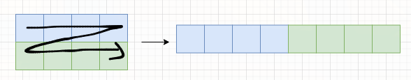
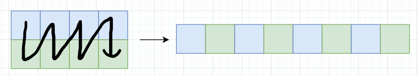

# Tensor

Tensor（张量）可以先简单理解为“带有形状的一组数据”。它可以有任意多个维度：

- 标量可以看成 0 维 Tensor，`shape = []`
- 向量是 1 维 Tensor，例如 `shape = [4]`
- 矩阵是 2 维 Tensor，例如 `shape = [2, 4]`

这里的“维度”指索引的个数，不是元素的数量。例如，一个形状为 `[2, 3, 4]` 的 Tensor 是 3 维 Tensor，一共有 `2 * 3 * 4 = 24` 个元素。

## Tensor的数据排布

在 Rust 中，我们当然可以给一维、二维、三维 Tensor 分别设计不同的数据结构，但这样做很快就会遇到麻烦：每增加一种维度，我们都要变换一种存储结构。比如，在一维时，我们可以用`Vec<f32>`表示Tensor，在二维时，就需要变换为用`Vec<Vec<f32>>`来表示数据了，当然，在三维会更加的麻烦。

一个更通用的办法是把所有元素连续地放进一维 `Vec<f32>`，再用 `shape` 记录它原本是什么形状：

```rust
pub struct Tensor {
    data: Vec<f32>,
    shape: Vec<usize>,
}
```

例如：

```text
data  = [1.0, 2.0, 3.0, 4.0, 5.0, 6.0]
shape = [2, 3]
```

可以表示下面这个两行三列的矩阵：

```text
[
  [1.0, 2.0, 3.0],
  [4.0, 5.0, 6.0],
]
```

## Shape 记录了什么

`shape` 中的每个数字，表示对应维度上有多少个元素。例如：

```text
shape = [2, 3, 4]
```

表示这个 Tensor 有 3 个维度，各维长度依次为 2、3、4。几个常用概念是：

```text
ndim  = shape.len()       = 3
numel = 2 * 3 * 4         = 24
```

其中 `ndim` 是维度数，`numel` 是元素总数。创建 Tensor 时，`data.len()` 必须等于 `numel`，否则数据和形状对不上。`from_vec()` 会检查这个不变量，并通过 `TensorResult` 返回构造结果：

```rust
let tensor = Tensor::from_vec(
    vec![1.0, 2.0, 3.0, 4.0, 5.0, 6.0],
    &[2, 3],
)?;
```

如果数据长度与 shape 不匹配，返回 `TensorError::DataLengthMismatch`；如果 shape 的元素总数无法用 `usize` 表示，返回 `TensorError::ShapeOverflow`。

## 多维数据怎样放进一维数组

只有 `shape` 还不够，我们还需要约定元素按照什么顺序放进 `data`。最常见的两种连续存储顺序是 row-major（行优先）和 column-major（列优先）。

### Row-major：行优先

行优先会先存完一整行，再存下一行：



假设矩阵是：

```text
[
  [a00, a01, a02, a03],
  [a10, a11, a12, a13],
]
```

它的 `shape = [2, 4]`，按行展开后得到：

```text
[a00, a01, a02, a03, a10, a11, a12, a13]
```

Rust 的嵌套数组和 C 风格数组通常都按这种顺序连续存放。

### Column-major：列优先

列优先会先存完一整列，再存下一列：



同一个矩阵按列展开后得到：

```text
[a00, a10, a01, a11, a02, a12, a03, a13]
```

可以看到，矩阵本身没有变，变的是元素在一维存储中的排列顺序。因此，`shape = [2, 4]` 只说明它有两行四列，不能单独说明它采用行优先还是列优先。

## 从二维坐标计算一维索引

对于一个 `shape = [m, n]` 的矩阵，使用从 0 开始的坐标 `(i, j)`：

- `i` 是行号，范围是 `0..m`
- `j` 是列号，范围是 `0..n`

在 row-major 中，每一行有 `n` 个元素。跳过前面的 `i` 行需要跨过 `i * n` 个元素，再向右移动 `j` 个位置，所以：

```text
index = i * n + j
```

在 column-major 中，每一列有 `m` 个元素。同理可得：

```text
index = j * m + i
```

还是以 `shape = [2, 4]` 为例，元素 `a12` 的坐标是 `(1, 2)`：

```text
row-major:    1 * 4 + 2 = 6
column-major: 2 * 2 + 1 = 5
```

这里算出的都是从 0 开始的一维索引。

## 推广到 N 维

二维矩阵的规则可以直接推广到任意维度。假设 Tensor 是连续的 row-major 布局：

```text
shape = [d0, d1, d2, ..., d(n-1)]
index = [i0, i1, i2, ..., i(n-1)]
```

那么一维索引为：

```text
offset = i0 * (d1 * d2 * ... * d(n-1))
       + i1 * (d2 * d3 * ... * d(n-1))
       + ...
       + i(n-2) * d(n-1)
       + i(n-1)
```

比如 `shape = [2, 3, 4]`，坐标 `(1, 2, 3)` 对应：

```text
offset = 1 * (3 * 4) + 2 * 4 + 3 = 23
```

也可以用循环来计算，这样就不用给不同维度分别写代码。当前实现先验证 rank 和每一维索引，再计算 offset：

```rust
fn offset(&self, indices: &[usize]) -> TensorResult<usize> {
    if indices.len() != self.shape.len() {
        return Err(TensorError::RankMismatch {
            shape: self.shape.clone(),
            expected: self.shape.len(),
            actual: indices.len(),
        });
    }

    for (axis, (&index, &size)) in
        indices.iter().zip(self.shape.iter()).enumerate()
    {
        if index >= size {
            return Err(TensorError::IndexOutOfBounds {
                shape: self.shape.clone(),
                axis,
                index,
                size,
            });
        }
    }

    let mut offset = 0;
    for (&index, &size) in indices.iter().zip(self.shape.iter()) {
        offset = offset * size + index;
    }

    Ok(offset)
}
```

这段代码使用的是连续 row-major 布局。以 `[2, 3, 4]` 为例，计算过程相当于：

```text
((i0 * 3) + i1) * 4 + i2
```

## 实现清单

在 Chapter 1.1 中，需要实现：

- 使用 `Vec<f32>` 和 `Vec<usize>` 保存 Tensor 的数据与 shape
- 使用 `zeros()`、`ones()` 和 `from_vec()` 创建 Tensor
- 使用 `numel()`、`shape()` 和 `ndim()` 查询 Tensor 属性
- 使用 `get()` 和 `set()` 按 N 维坐标访问元素
- 使用 `TensorError` 报告 shape 溢出、数据长度不匹配、rank 不匹配和索引越界
